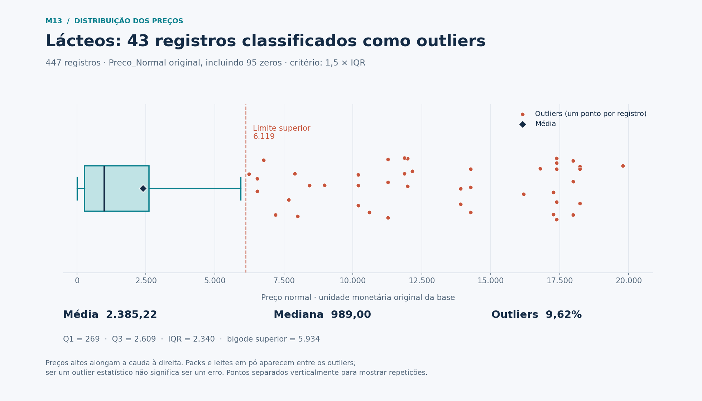
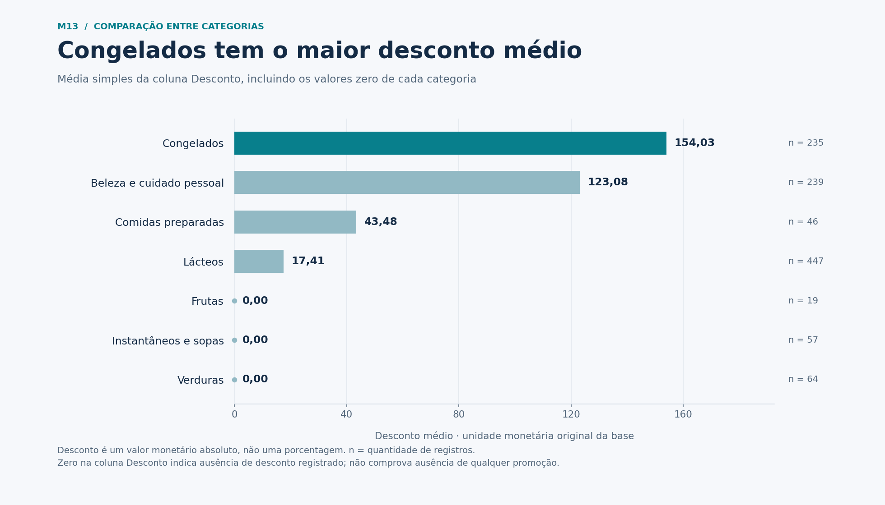
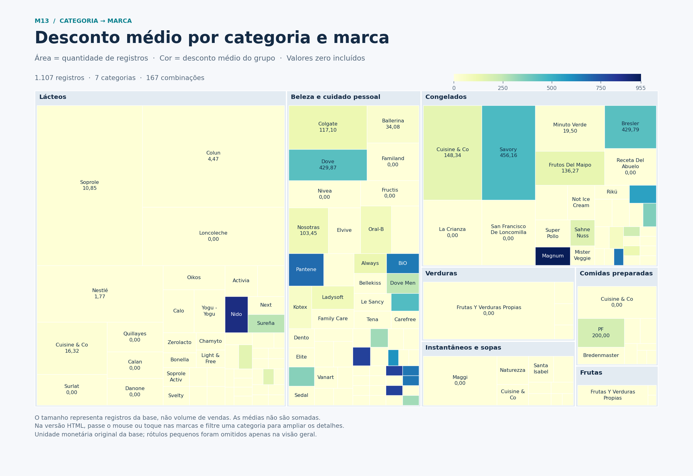

# Projeto M13 — Fundamentos da Descoberta de Dados

Análise descritiva de produtos de um supermercado do Chile: média, mediana, desvio padrão, identificação de outliers, gráfico de barras e mapa interativo de categoria e marca.

**Link para entrega:** https://github.com/mrlnasc/projeto-m13-supermercado

[Abrir o notebook completo](Profissao_Cientista_de_Dados_M13_Projeto.ipynb)

## Resultados principais

| Categoria original | Registros | Média | Mediana | Desvio padrão amostral | Média × mediana |
|---|---:|---:|---:|---:|---|
| lacteos | 447 | 2.385,22 | 989,00 | 3.925,82 | Acima |
| belleza-y-cuidado-personal | 239 | 1.783,56 | 1.569,00 | 2.210,04 | Acima |
| congelados | 235 | 2.108,04 | 1.519,00 | 2.111,54 | Acima |
| comidas-preparadas | 46 | 3.095,04 | 3.290,00 | 2.019,91 | Abaixo |
| frutas | 19 | 1.724,47 | 1.195,00 | 1.639,15 | Acima |
| instantaneos-y-sopas | 57 | 765,49 | 439,00 | 1.170,23 | Acima |
| verduras | 64 | 1.343,30 | 1.180,00 | 1.012,70 | Acima |

- Seis categorias têm média acima da mediana. Somente `comidas-preparadas` tem média abaixo da mediana na coluna original.
- Lácteos apresenta o maior desvio padrão: **3.925,82**. A média de **2.385,22** supera a mediana de **989,00**; preços elevados alongam a cauda à direita.
- A regra de Tukey identifica **43 outliers superiores (9,62%)**, nenhum inferior. Q1 = 269; Q3 = 2.609; IQR = 2.340; limites = −3.241 e 6.119. Os bigodes chegam a 0 e 5.934. Os outliers vão de 6.229 a 19.788.
- Congelados possui o maior desconto médio por categoria: **154,03**, seguido de beleza e cuidado pessoal: 123,08; comidas preparadas: 43,48; lácteos: 17,41. As outras categorias têm média zero na coluna `Desconto`.
- No agrupamento por categoria e marca, `congelados → Magnum` tem a maior média de desconto: **955,00**, com 4 registros. `lacteos → Nido` tem média de 869,80, com 5 registros.

## Critérios e limitações

A base contém **1.107 registros, 7 categorias e 156 marcas**, sem valores `NaN`. O delimitador correto é vírgula. As categorias originais estão em espanhol; os gráficos usam rótulos em português.

Os cálculos obrigatórios usam `Preco_Normal` e `Desconto` como fornecidos. Foram preservados **294 preços normais iguais a zero**, **989 descontos iguais a zero** e **duas linhas duplicadas além da primeira ocorrência**. Não houve exclusão de registros nem substituição de preços.

Preço normal zero não indica necessariamente um produto gratuito: 244 desses registros têm preço com desconto positivo, e 50 têm todos os preços zerados. A análise complementar com `Preco_Normal > 0` está no notebook e nos resultados. Nela, comidas preparadas passa a ter média acima da mediana. Os resultados principais continuam usando a coluna original solicitada.

O desvio padrão é amostral (`ddof=1`); os quartis usam interpolação linear. Um outlier está estritamente abaixo de `Q1 − 1,5 × IQR` ou acima de `Q3 + 1,5 × IQR`. Packs e diferentes embalagens ajudam a explicar os extremos; outlier não significa necessariamente erro.

`Desconto` é um valor monetário absoluto, não um percentual. As médias incluem os zeros. Os valores permanecem na unidade monetária original, sem conversão para reais. Contagens representam registros, não quantidade vendida; a base não permite concluir sobre margem, faturamento ou eficácia comercial de promoções.

## Visualizações

### Boxplot de lácteos



### Média de desconto por categoria



### Mapa de categoria e marca



[Arquivo do mapa interativo](graficos/03_mapa_interativo.html) · [Baixar HTML](https://github.com/mrlnasc/projeto-m13-supermercado/raw/refs/heads/main/graficos/03_mapa_interativo.html)

Salve o HTML e abra-o no navegador. Ele funciona offline, permite selecionar uma categoria e exibe detalhes por marca ao passar o mouse, tocar ou usar Tab. A área representa a quantidade de registros dentro da categoria; a cor representa a média de desconto. A escala permanece fixa entre filtros, e grupos com média zero continuam visíveis. É um treemap, não um mapa geográfico.

## Executar o projeto

Ambiente utilizado na análise: **Python 3.12**, pandas 2.2.3, NumPy 2.3.5 e Matplotlib 3.10.8.

Baixe ou clone o repositório e, dentro da pasta do projeto, execute:

```bash
python -m pip install -r requirements.txt
python analise.py
```

Para usar o notebook, abra `Profissao_Cientista_de_Dados_M13_Projeto.ipynb` no Jupyter e execute as células na ordem. Mantenha o CSV e `visualizacoes.py` na mesma pasta. Se precisar instalar a interface, use `python -m pip install notebook` e `python -m notebook`.

O notebook já contém as saídas da análise. O script recria os gráficos em `graficos/` e as tabelas em `resultados/`. As funções de visualização usam Matplotlib e HTML/SVG; o mapa não depende de bibliotecas web externas.

| Arquivo ou pasta | Conteúdo |
|---|---|
| `Profissao_Cientista_de_Dados_M13_Projeto.ipynb` | Notebook com código, saídas e interpretações |
| `analise.py` | Código das células em formato de script |
| `visualizacoes.py` | Funções dos gráficos e do mapa interativo |
| `MODULO7_PROJETOFINAL_BASE_SUPERMERCADO.csv` | Base original preservada |
| `requirements.txt` | Dependências utilizadas |
| `graficos/` | Três PNGs e o mapa interativo HTML |
| `resultados/` | Estatísticas, descontos, outliers e análise complementar em CSV |

## Entrega no curso

Envie o link deste repositório e estas três imagens:

1. [01_boxplot_lacteos.png](graficos/01_boxplot_lacteos.png)
2. [02_desconto_por_categoria.png](graficos/02_desconto_por_categoria.png)
3. [03_mapa_categoria_marca.png](graficos/03_mapa_categoria_marca.png)

O HTML preserva a versão interativa do mapa. As interpretações completas e os 43 registros classificados como outliers estão no notebook e nos CSVs.

## Fonte

Base de dados e enunciado fornecidos no projeto do Módulo 13. As conclusões decorrem exclusivamente desse CSV.
